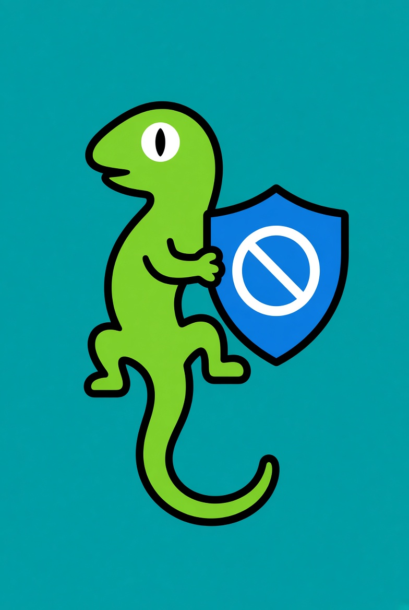

# 🦎 twitch-adblock

<p align="center"></p>

**A Chrome extension (Manifest V3, version 0.2.21) that blocks ads on Twitch, YouTube, Kick, and other websites.** It works inside Chrome: no separate program, no account.

<p align="center"> &nbsp; </p>

The toolbar gecko is green with an amber glowing eye while blocking on ordinary sites is on, and grey with a half-shut eye when it is off. Twitch, YouTube, and Kick filters keep running either way.

## What it does and doesn't do

- ✅ Blocks video ads on Twitch, YouTube, and Kick.
- ✅ Blocks ads on other websites using public ad lists, and hides the empty boxes the ads leave behind.
- ❌ Ads that are part of the video itself still play. Example: a YouTuber reading out a sponsor.
- ❌ On Twitch, the picture can drop to lower quality for a moment during an ad break. The stream keeps playing.
- ❌ Sometimes a Twitch ad still shows, when no ad-free copy of the stream is available.
- ❌ On Kick, some ads still play. It only skips an ad when it can do that safely.
- ❌ YouTube Music and YouTube Kids are not covered.

## Install

1. Get the files and unzip them. Pick one:
   - **Release zip:** [twitch-adblock-0.2.21.zip](https://github.com/gecko-of-shadow/twitch-adblock/releases/download/v0.2.21/twitch-adblock-0.2.21.zip) ([release v0.2.21](https://github.com/gecko-of-shadow/twitch-adblock/releases/tag/v0.2.21), [all releases](https://github.com/gecko-of-shadow/twitch-adblock/releases)). The 0.2.21 zip came out before the "Allow this page" fix, so in that copy the button always stays grey.
   - **Newest code:** click the green **Code** button on this page, then **Download ZIP**. A copy from **Download ZIP** has the fix. It may be newer than the last numbered release; Chrome still shows the version number of that release.
2. In Chrome, type `chrome://extensions` in the address bar and press Enter. If you had an older copy loaded, remove it first.
3. Turn on **Developer mode** (top right). This switch lets Chrome add an extension from a folder on your computer.
4. Click **Load unpacked** and pick the unzipped folder: the one with `manifest.json` directly inside it. Keep the folder where it is. Chrome runs the extension from that folder.
5. Optional: click the puzzle-piece icon next to the address bar, then the pin next to **twitch-adblock**. The gecko then stays visible in your toolbar (the row of icons to the right of the address bar).

## How to use

1. Click the gecko in the toolbar. A small window opens.
2. The **Block ads on ordinary sites** switch turns blocking on other websites on or off. It starts on.
3. If a website breaks while ads are blocked, open it, click the gecko, and click **Allow this page**.
4. The button now says **Blocking this page** and is highlighted. That means the site is allowed. Reload the page.
5. To undo, click **Blocking this page** on the same website, then reload.

An allow counts for the whole website address and stays until you undo it. Details: [docs/allow-a-page.md](docs/allow-a-page.md)

## Privacy

- No tracking: it does not send your browsing history anywhere.
- No account, and no analytics call of its own. Settings stay in Chrome's storage on this browser.
- It downloads nine public filter lists (EasyList, EasyPrivacy, AdGuard Base, and others) from the [list sites](docs/permissions-and-privacy.md#host-permissions), over HTTPS without cookies. Those sites see the list address and your IP address, not the page you are on.
- On Twitch, it asks Twitch for ad-free copies of the stream. Those requests go to Twitch.

Full details, permissions, and the list sites: [docs/permissions-and-privacy.md](docs/permissions-and-privacy.md)

## Troubleshooting

- **"Allow this page" is grey?** The line under it says why:
  - *Turn general blocking on to change page allows.* Turn on the **Block ads on ordinary sites** switch first.
  - *Open a normal http(s) page to allow it. Already on one? Reload it.* Allowing does not work on Twitch, YouTube, Kick, or Chrome pages. On a normal website, the page was open before you installed or reloaded the extension: reload it, then open the window again.
- **Blocked things still missing after you allow a site?** Reload the page.
- **Loading a new copy?** Remove the old one at `chrome://extensions` first. A copy from a different folder forgets the allowed sites, so allow them again.

## Links

- **Docs:** [How it works](docs/how-it-works.md) · [Allow a page](docs/allow-a-page.md) · [Permissions and privacy](docs/permissions-and-privacy.md)
- **Permissions:** `storage` and `declarativeNetRequest`, plus download access to nine filter-list sites. [Full list](docs/permissions-and-privacy.md#permissions)
- **Credits and licenses:** TwitchAdSolutions (MIT), uBlock Origin and uAssets (GPLv3), the EasyList authors and the other lists. [Details and license files](docs/credits.md)
- **Development:** there is no build step. From a git clone, load the repository root (the directory that contains `manifest.json`); `docs/`, `test/`, and `scripts/` are not part of the running extension. The version is the `version` field in `manifest.json`. The release zip root is `manifest.json`, `src/`, and `icons/`, and `scripts/pack-zip.sh` writes `twitch-adblock-<version>.zip` containing the same three.

```bash
deno test --no-lock --allow-read --allow-run --allow-env test/
bash scripts/release-gate.sh
bash scripts/pack-zip.sh
```
