# twitch-adblock

**Watch the live stream. Ads stay off your screen.**

- The stream keeps playing. No black screen, no reload loop.
- Works with several live tabs open.
- Free. No account. Nothing leaves your computer.

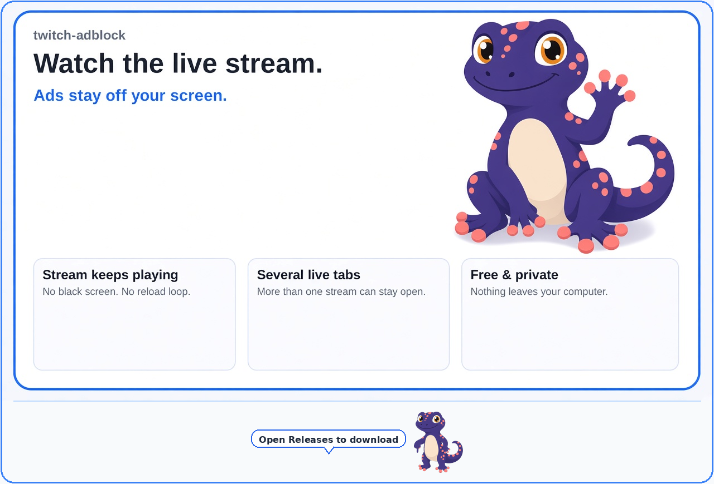

A free Chrome extension for Twitch, YouTube, Kick, and ordinary websites. It runs only in your browser and does not send data anywhere. There is one download.

## What it does

- **Twitch live:** during a commercial break, it switches to a clean copy of the same stream, then switches back when the break ends. If a clean copy is not available, the ad may play so your video does not freeze. The Browse directory hides the top banner slot and the in-grid Ad cards.
- **YouTube:** removes player ads and Sponsored cards on Home and in search. The start-buffer wait is cleared, and the server start switch stays on so the picture can leave the spinner. The "Experiencing interruptions?" toast is hidden and left in the page, so it does not keep opening again.
- **Kick:** when the player can jump back to the live stream, short ad breaks are skipped. If a skip is not safe, the ad may play.
- **Other sites:** many known ad servers are blocked, and leftover ad boxes are hidden. This does not block every ad. IMDb sponsored billboards are hidden. Posters stay.
- VODs and clips are left alone.

General blocking starts **on**. The popup can turn it off, or allow the open page. **Update lists** only remembers that you asked. It does not download a new list. Twitch, YouTube, and Kick playback stay out of that list.

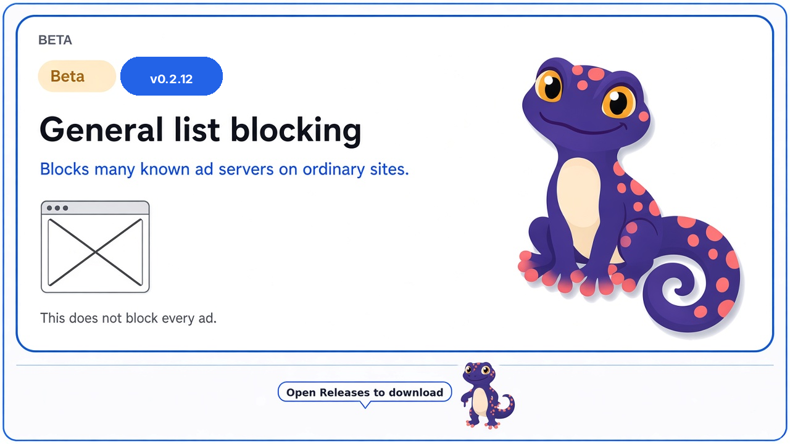

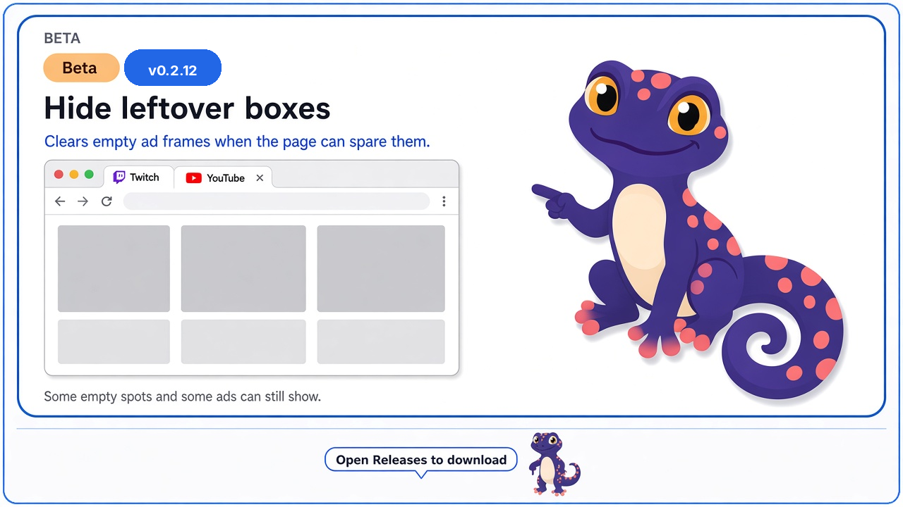

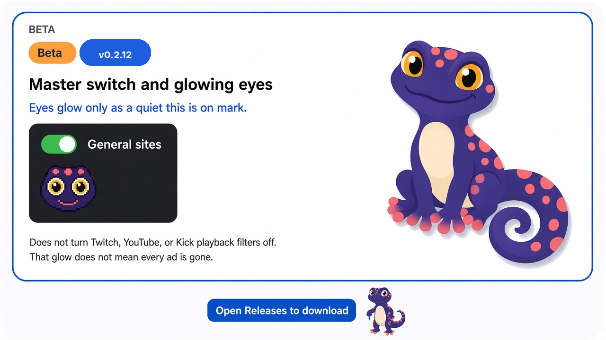

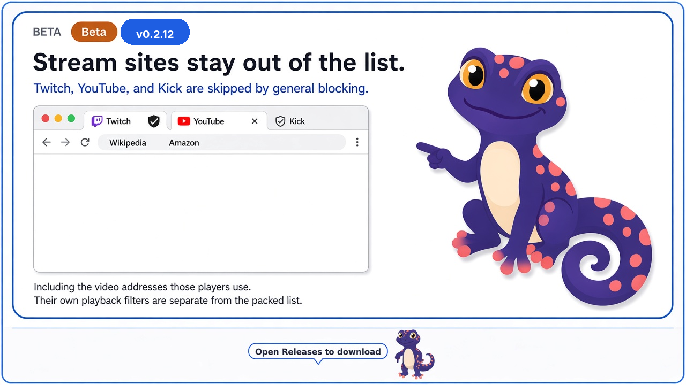

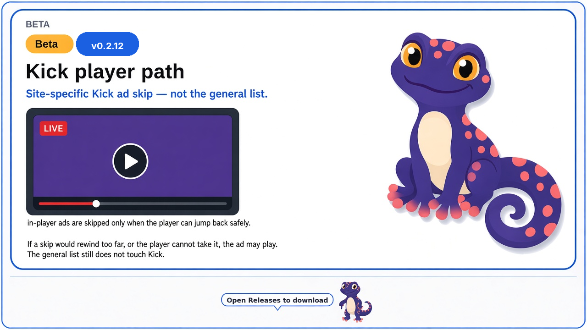

## Is this safe?

It runs inside Chrome. It does not install a program on your PC.

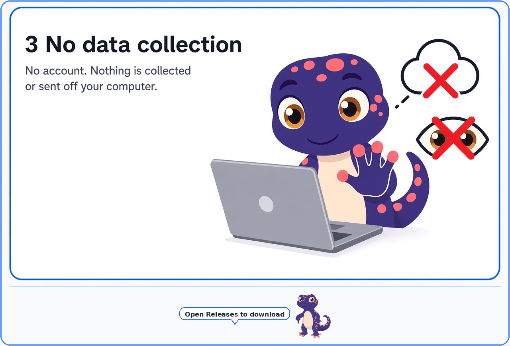

- **No data collection** — no account, nothing collected, nothing sent off your computer.
- Stream playback handling is Twitch, YouTube, and Kick. General blocking also runs on ordinary websites, so Chrome may say it can block content on those pages.

## Current build

**v0.2.20** is the zip on Releases: Twitch, YouTube, Kick, and ordinary-site blocking in one download. If you still have the older v0.2.3 zip or the v0.2.12 beta folder loaded, remove the extra one.

The toolbar icon is a gecko head. Its eyes glow while general blocking is on.

This repository folder is **v0.2.20**, the same as the Releases zip.

## Install (for first-time Chrome installs)

You do **not** need a GitHub account. You are only downloading a zip and loading it in Chrome like a local app.

### 1. Open the release page

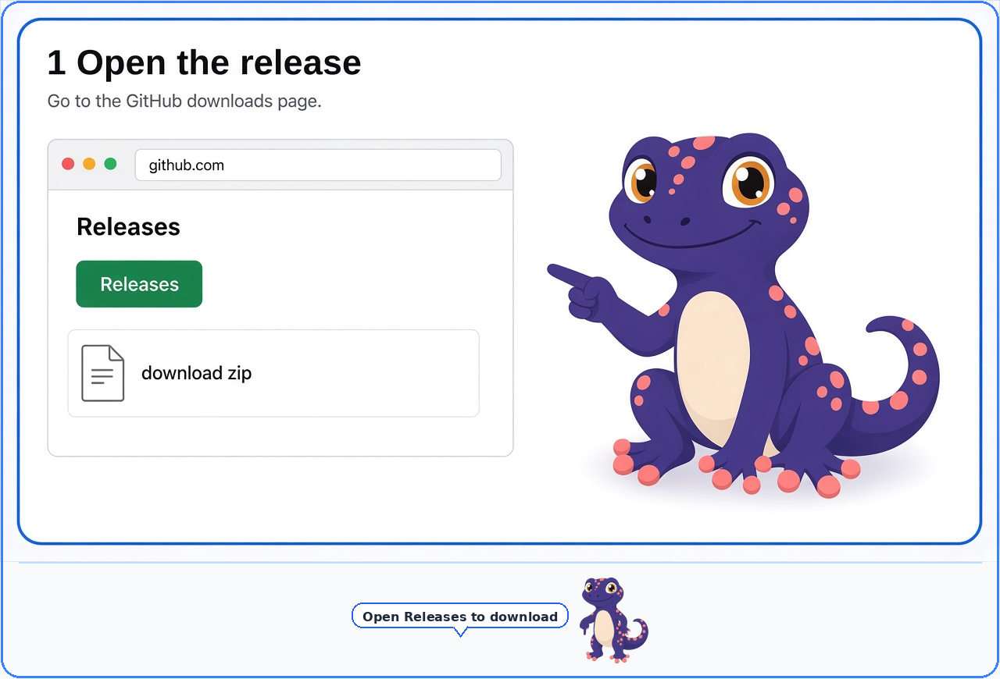

Or skip ahead and use the download button in step 2.

### 2. Download the zip

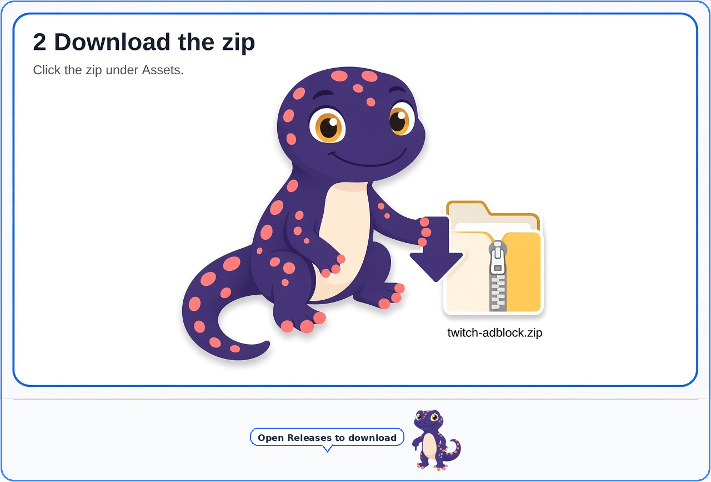

Open **[Releases](https://github.com/gecko-of-shadow/twitch-adblock/releases/latest)** and download the zip under **Assets** — or use this direct link:

**[Download twitch-adblock-0.2.20.zip](https://github.com/gecko-of-shadow/twitch-adblock/releases/download/v0.2.20/twitch-adblock-0.2.20.zip)**

### 3. Unzip the folder

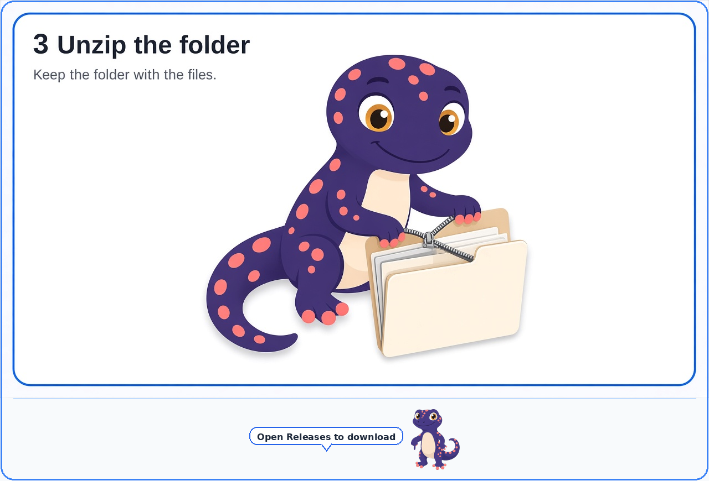

- Windows: right-click the zip → **Extract All…**
- Mac: double-click the zip

Keep the folder that appears. Do not delete it after install — Chrome reads the extension from that folder.

### 4. Open Chrome Extensions

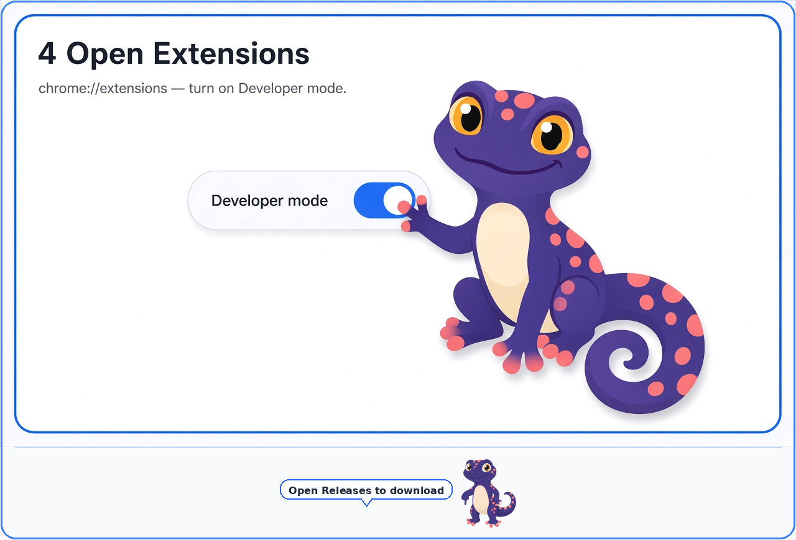

1. Open a new tab and go to `chrome://extensions`
2. Turn on **Developer mode** (top right)

### 5. Load unpacked

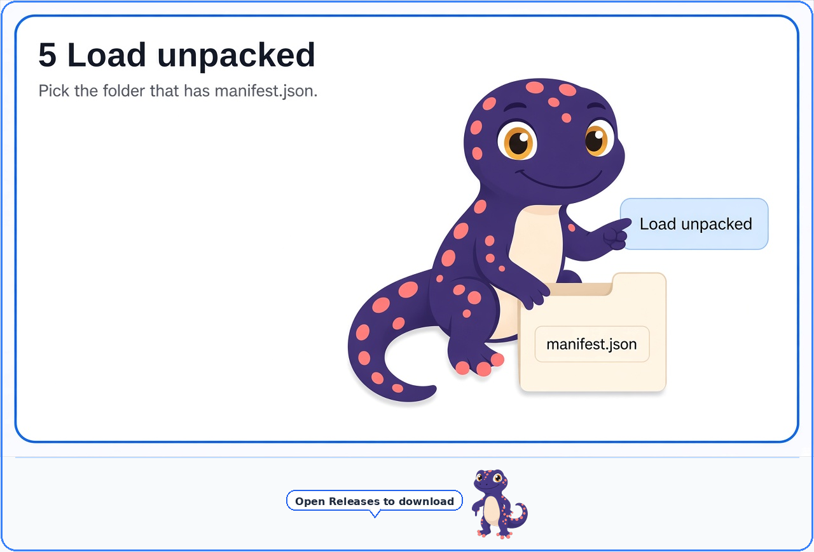

1. Click **Load unpacked**
2. Choose the unzipped folder (the one that contains `manifest.json`)
3. You should see twitch-adblock in the list, with the gecko icon

Turn off other Twitch or YouTube ad blockers while this is loaded. Two ad blockers on the same page can freeze the video.

**[Open Releases to download →](https://github.com/gecko-of-shadow/twitch-adblock/releases/latest)**

## Notes

- Picture quality can dip briefly during a Twitch ad break. Playback should keep going.
- Ads already baked into a YouTube video file still play.
- Development: `deno test --no-lock test/` · `bash scripts/release-gate.sh` · `bash scripts/pack-zip.sh`
